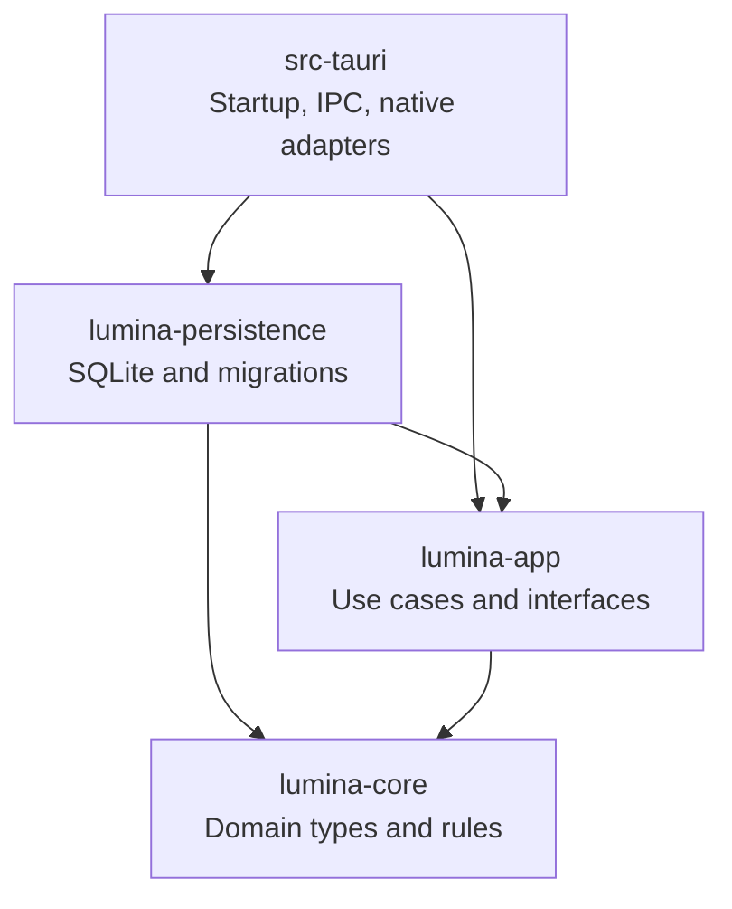

# Architecture design

The maintainer has confirmed the architecture design and foundation specification. Implementation is specified in [GitHub issue #11](https://github.com/Kertsu/lumina/issues/11). The static frontend slice ([#12](https://github.com/Kertsu/lumina/issues/12)) supplies React/Vite/Router startup, route entry points, and the welcome capability. The Rust startup slice ([#13](https://github.com/Kertsu/lumina/issues/13)) supplies the Cargo workspace, explicit composition root, one blocking execution boundary, and managed bundled SQLite initialization/migrations. The remaining foundation below is the agreed target; see [README](../README.md) for implemented commands and responsibilities. Maintainer runtime verification remains pending.

## Maintainer goal

The maintainer should be able to understand, debug, and change both stacks personally without depending on coding agents. Optimize for predictable code locations, direct control flow, explicit dependencies, small public interfaces, and checks that explain failures.

Assess a module by whether a maintainer can find its responsibility, trace its callers, understand its dependencies, and verify a change. Additional layers and abstractions must improve those tasks.

## Agreed foundation

- React, Vite, and TanStack Router for the static desktop frontend: [ADR 0005](adr/0005-use-static-react-frontend.md).
- Rust owns accepted application state and workflow decisions; React owns interaction state: [ADR 0006](adr/0006-own-application-state-in-rust.md).
- One managed SQLite database for Bible content/indexes and persistent application data: [ADR 0007](adr/0007-use-one-managed-sqlite-database.md).
- Three Rust libraries plus the desktop shell: [ADR 0008](adr/0008-separate-application-library-from-tauri.md).
- Frontend modules grouped by capability; Radix-backed shadcn/ui supplies editable shared UI source.
- Rust-owned IPC contracts generated through `tauri-specta`, committed TypeScript output, and CI drift checks.
- Standardized public error codes; messages are display text: [ADR 0010](adr/0010-standardize-code-based-application-errors.md).
- Lightweight dependency checks using Cargo and existing Biome capabilities.
- One routine verification command shared with CI; individual checks remain available.

Existing MVP behavior and other accepted ADRs remain authoritative. This document focuses on codebase organization and developer workflow.

## Target code layout

```text
Cargo.toml              # Rust workspace
crates/
  lumina-core/          # Domain types and rules
  lumina-app/           # Use cases, application errors, integration interfaces
  lumina-persistence/   # SQLite operations and migrations
src-tauri/              # Desktop startup, IPC, native adapters
src/
  app/                  # Startup, providers, screen composition
  routes/               # Router entry points
  features/             # Related UI, hooks, and tests together
  bridge/               # Generated contracts, typed Rust access, browser adapter
  shared/ui/            # Editable Radix-backed shadcn/ui and shared UI
```

Create modules as implemented responsibilities require them. The target layout does not call for a forest of empty placeholder files.

## Rust responsibilities and dependencies

| Crate | Owns | Dependency rule |
| --- | --- | --- |
| `lumina-core` | Domain types, invariants, pure rules | Independent of application, SQLite, and Tauri |
| `lumina-app` | Use cases, authoritative application state, public failures, storage/native interfaces | Depends on `lumina-core`; independent of concrete SQLite and Tauri |
| `lumina-persistence` | SQLite access, transactions, migration implementation | Implements application storage interfaces; uses core types |
| `src-tauri` | Executable startup, typed IPC, native adapters, desktop runtime integration | Constructs and connects application/persistence/native implementations |

Each arrow points from a crate to a crate it depends on.



`lumina-persistence` depends on the storage interfaces defined by `lumina-app`; the application stays independent of the SQLite implementation.

Startup is one explicit composition root in `src-tauri`. Keep ordinary structs/functions and capability-sized interfaces at real integration seams; avoid mandatory handler/service/repository/mapper chains for every change. Reuse types where their meanings match and map representations where meanings differ.

## Frontend responsibilities

- `app` and routes compose features and provide startup dependencies.
- Features keep related UI, interaction hooks, and tests together. Begin flat; split files/subfolders when their responsibilities justify it.
- Expose small public module interfaces. Other modules do not reach into feature internals.
- Rust access goes through the typed bridge; direct native imports stay there.
- Shared UI stays independent of application rules, feature modules, and the native bridge.
- Browser development uses representative fixtures through the same frontend interface. Fixtures provide states for UI work without duplicating Rust application rules; integration verification uses real Tauri.

Use Radix-backed shadcn/ui, selecting Radix explicitly during setup. Its source lives in `src/shared/ui` and is maintained as editable project code. Set `components.json`'s `aliases.ui` to `@/shared/ui`, keeping TypeScript and Vite aliases consistent; feature-specific compositions remain with their feature.

Sources: [shadcn aliases](https://ui.shadcn.com/docs/components-json#aliasesui), [CLI library selection](https://ui.shadcn.com/docs/cli), [source ownership](https://ui.shadcn.com/docs#open-code).

## Persistence and execution

Use `rusqlite` with bundled SQLite inside `lumina-persistence`. Keep SQL and migration implementation together in that crate; application/domain code does not expose SQLite connection or row types.

Persistence operations are synchronous. `DesktopRuntime` in `src-tauri/src/runtime.rs` routes startup and native application calls through one `spawn_blocking` boundary. A worker acquires the application mutex; the application retains one `SqliteStorage` connection. The setup hook in `src-tauri/src/lib.rs` constructs those dependencies in its startup closure and returns before database work completes. Core/application/persistence remain Tauri-independent. See [README](../README.md#rust-responsibilities-and-startup) for location, lifecycle, migration behavior, diagnostics, and native-free verification commands. Product schema details follow feature needs.

Verify bundled FTS5 availability through the actual application dependency/build path rather than relying on the developer's system SQLite.

Sources: [rusqlite](https://docs.rs/rusqlite/0.40.2/rusqlite/), [Tauri async runtime](https://docs.rs/tauri/2.11.1/tauri/async_runtime/index.html).

## Standard error contract

The public contract belongs in `lumina-app` and is defined once in Rust.

| Field | Meaning |
| --- | --- |
| `errorCode` | Required stable machine-readable identifier; used for UI branching |
| `message` | Human-readable explanation; changing wording must not change behavior |
| `data` | Structured payload typed for the particular code, when needed |

Define code variants and their payloads together so generated TypeScript preserves the relationship between an error code and its data. Do not maintain separate code catalogs in the Tauri shell or TypeScript. Public codes are explicit contract values, not values that accidentally change when an internal Rust symbol is renamed.

Internal modules retain appropriate typed errors and source causes. Translate them into application failures at integration seams and preserve diagnostic context. The Tauri shell serializes the public contract; the frontend bridge handles unexpected invocation/transport failures centrally, exposing code-based failures to UI callers. UI code never parses error-message text or blindly casts an unknown rejection into a known application error.

The contract does not carry HTTP status. Specific feature codes and exact signatures are defined with their implementations; this design establishes the convention and ownership.

Reference pattern: the corporate `ApiError` envelope and policy `ServiceApiErrorCode` catalog. Lumina strengthens that pattern with mandatory codes and per-code typed payloads in place of nullable codes and untyped data.

## Generated contracts and dependency checks

- Rust command/event/error declarations are the source of truth. Use `tauri-specta` to generate TypeScript under `src/bridge`; commit the output and treat it as read-only.
- Binding generation uses the application's command/event registration and works without opening a desktop window. Check generation drift in CI, then typecheck the frontend.
- Pin compatible released Specta/Tauri Specta versions during setup; their v2 integration is currently prerelease. Keep generator-specific registration in the desktop integration.
- Cargo dependency declarations and Rust visibility express crate/module separation. Review changes to crate manifests for forbidden additions.
- Use a small Biome import-rule set for direct Tauri imports and canonical alias imports across frontend modules. Prefer existing tools over a custom dependency-analysis subsystem.
- Verified limitation: installed Biome 2.4.14 restrictions match written import paths. Relative paths or alternate aliases can bypass rules unless covered; use one documented cross-module alias convention and retain review for cases simple rules cannot prove. Symbol-visibility rules are not comprehensive feature-folder privacy.

Source: [released Tauri Specta setup](https://raw.githubusercontent.com/specta-rs/tauri-specta/v2.0.0-rc.25/src/lib.rs).

## Testing and debugging

| Scope | Placement and approach |
| --- | --- |
| Rust unit tests | Alongside their modules |
| Rust integration tests | Each crate's `tests/` directory, observing public interfaces |
| Persistence integration tests | Real temporary SQLite databases |
| React tests | Beside their feature/module |
| Native integration checks | With the desktop shell; distinguish automated checks from packaged/native verification |

Application and persistence tests run independently of Tauri. Test meaningful observable outcomes; avoid tests that merely repeat implementation details. Existing MVP testing guidance still applies.

Keep expected failures inspectable by code and retain underlying causes for debugging. Document one normal terminal/devtools diagnostic path and useful entry points instead of introducing a separate diagnostics framework.

## Planned developer commands

These are target conventions, not scripts already implemented.

| Command | Purpose |
| --- | --- |
| `pnpm dev` | Run the desktop development application |
| `pnpm dev:vite` | Run frontend development with the browser adapter |
| `pnpm bindings:generate` | Regenerate committed TypeScript IPC contracts |
| `pnpm bindings:check` | Detect generated-contract drift |
| `pnpm check` | Run frontend, Rust, and contract checks used by CI |
| `pnpm build` | Build the packaged desktop application |

`pnpm check` covers frontend lint, typechecking, tests, Rust formatting, Clippy, Rust tests, and generated-contract drift. Keep individual commands available for iteration. Preserve the declared Node/pnpm versions and both lockfiles, and pin a Rust toolchain during setup. Document the required native build dependencies.

## Foundation work after design confirmation

1. Create the Cargo workspace and agreed crate interfaces; fix lint inheritance and wire startup explicitly.
2. Simplify the frontend to React/Vite/Router and apply the agreed layout with Radix-backed shadcn/ui.
3. Establish the typed IPC/error contract, deterministic binding commands, and browser development adapter.
4. Wire simple import guards, test locations, and the shared local/CI check command.
5. Verify the foundation and write a short README/change guide: prerequisites, run/build/check commands, responsibility locations, entry points, tests, and debugging.

The guide should let a maintainer trace a call from a React feature through the typed bridge and Tauri handler into an application operation and its domain/persistence dependencies. Concrete feature examples can be added when that code exists.

## Review status and scope

The maintainer approved the [foundation specification](specs/codebase-foundation.md) and its verification scenarios. Static frontend and Rust startup are implemented in their respective slices; typed integration, shared UI, shared verification/CI, and the final maintainer walkthrough remain separate foundation work.

Detailed feature behavior, algorithms, complete schemas, and protocol mechanics belong to feature design. Earlier unanswered feature-level recommendations are not accepted requirements. Existing MVP behavior and accepted ADRs remain authoritative.
